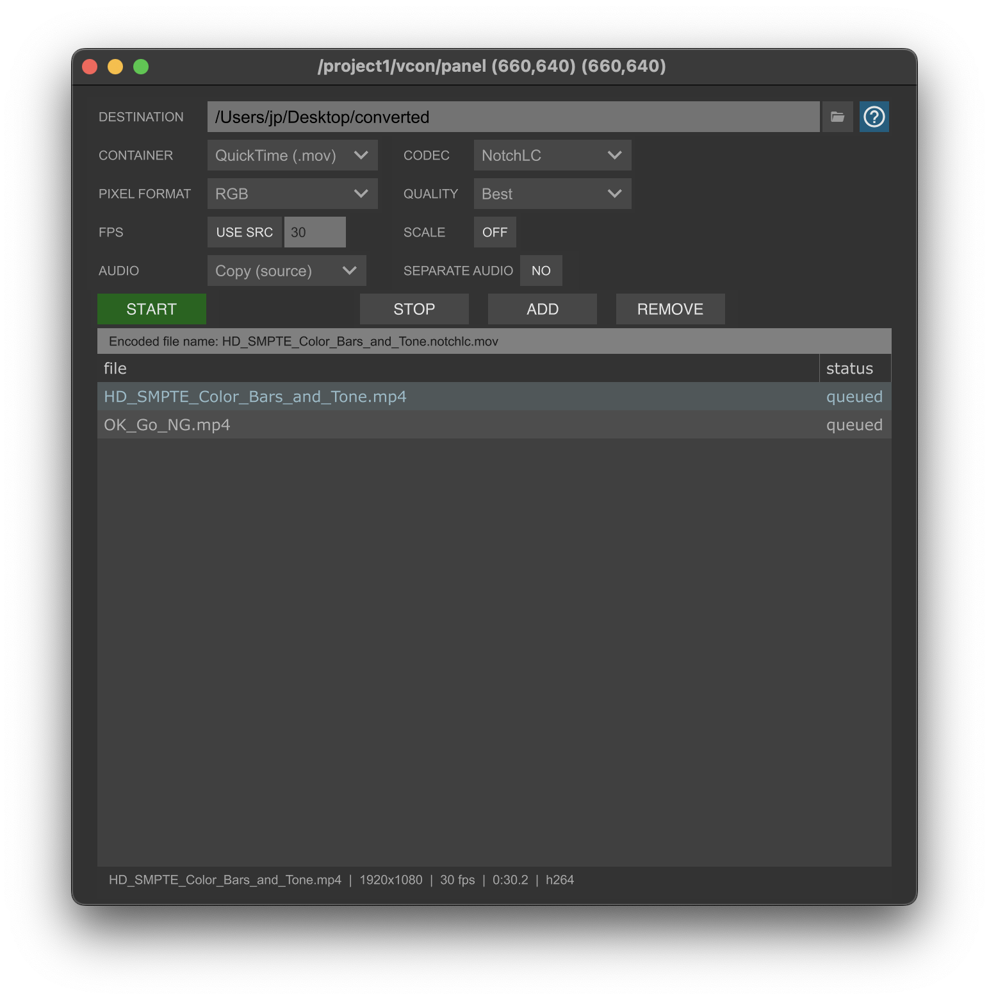

# TDXvCon

A TouchDesigner project for batch video transcoding through Movie File Out TOP.
Queue files, configure output settings, and encode to NotchLC, Hap, ProRes,
CineForm, H.264, or H.265 from a single panel. An optional CLI supports scripted
workflows.



## Quick start — TouchDesigner

Requires TouchDesigner on macOS or Windows, licensed for your intended use.
Codec availability and output limits depend on the build, platform, and license.

1. Download [TDXvCon-1.0.0.toe](https://github.com/jpkelly/TDXvCon/releases/download/v1.0.0/TDXvCon-1.0.0.toe)
   from the [v1.0.0 release](https://github.com/jpkelly/TDXvCon/releases/tag/v1.0.0).
2. Open the project in TouchDesigner. The queue panel is at
   `/project1/vcon/panel` (right-click the component and select **View** if needed).
3. Choose a **DESTINATION**, **CONTAINER**, and **CODEC**. Set the pixel format,
   quality, FPS, scaling, and audio options as needed.
4. Drop video files into the queue or click **ADD**, then click **START**.

The panel uses the embedded controller directly; the Python package and CLI
are not required for video encoding. Alpha support depends on the codec and
subtype. Allow sufficient disk space for intermediate codecs.

### Audio setup

Audio muxing and separate audio export require FFmpeg. Click **?** to open
**Setup & Help**, then **Install Now** if audio support is missing. This downloads
`imageio-ffmpeg` into vCon's user data folder and requires an available Python
interpreter with pip. The dialog also provides a manual install command.
An existing FFmpeg executable on TouchDesigner's `PATH` can be used instead.

Choose the desired **AUDIO** mode before starting: the shipped default is
no audio. FFmpeg is not bundled in the project.

## Optional command-line interface

Requires Python 3.10+, [pipx](https://pipx.pypa.io/stable/installation/), and
TouchDesigner. The package is `tdxvcon`; the command is `vcon`.

```sh
pipx install tdxvcon
vcon -doctor
vcon -i input.mov -c notchlc -q optimal output.mov
vcon -i input.mov -c prores -t 4444xq output.mov
vcon -i input.mov -c hap -t hapq output.mov
```

Specify a codec for each output; output options precede its path. Use `-y` to
overwrite, `vcon -h` for options, and `vcon -codecs` for registry entries.
The CLI attaches to a running controller or launches the packaged project.
`-doctor` checks the installation and probes an existing controller without
launching TouchDesigner. The exit status is 0 when every job encoded, 1 when
a job failed, 2 when TouchDesigner failed, and 3 when every job encoded but
one printed a warning (for example, a failed audio mux left a video-only file). Set `VCON_TDPATH` or pass `-td-path PATH` if detection fails.

## Development and limitations

The panel and CLI share a TouchDesigner controller. The panel calls it directly;
the CLI uses a TCP JSON-lines protocol. TouchDesigner encodes video, and FFmpeg
handles audio post-processing. See the [protocol reference](toe/PROTOCOL.md).

This is alpha software. Automated tests cover the Python core and a simulated
controller, not the panel, GPU encoding, or every platform/codec combination.
The TCP protocol has no authentication; keep its port (default `7999`)
inaccessible to untrusted clients.

See [CONTRIBUTING.md](CONTRIBUTING.md) for source setup, tests, and project
rebuilds, and [PUBLISHING.md](PUBLISHING.md) for releases.

## License

[MIT](LICENSE). TouchDesigner and other third-party components retain their
own licenses.
